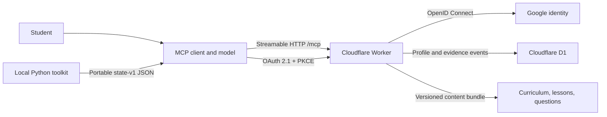
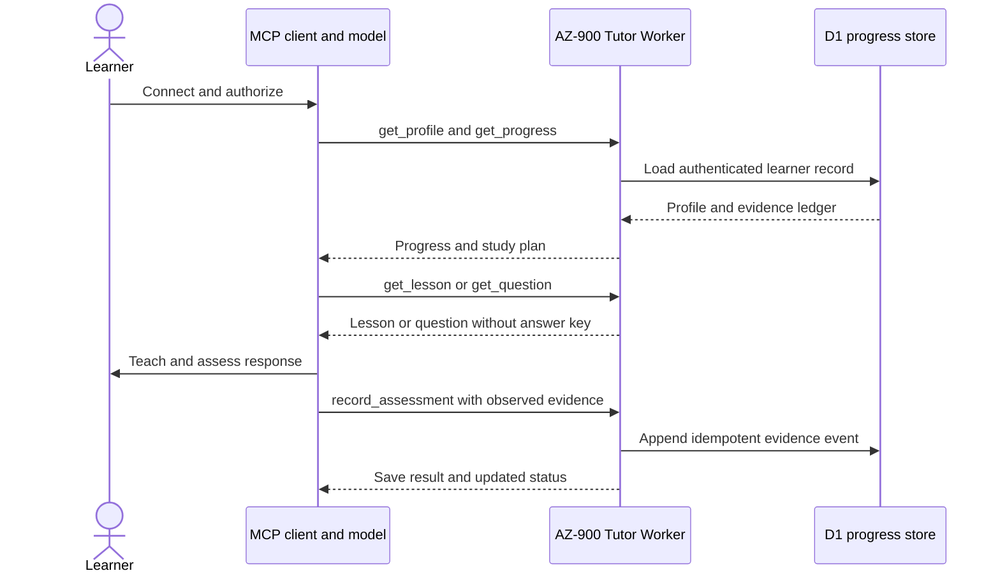

# ADR 001 — Files as the tutor's public contract

Accepted 2026-10-15. Target: beginners and experienced developers preparing for
AZ-900 with an agent, including Portuguese speakers and students moving between agents.

The hard problem is selecting and assessing learning against current objectives,
not generating another explanation of cloud computing.

Use versioned JSON curriculum, curated resources and original assessment items;
Markdown pedagogy and an Agent Skill; Python 3.11+ standard-library tools for
validation, local progress and conservative source monitoring. JSON avoids a YAML
runtime dependency and has unambiguous interoperable types. Data is authoritative;
human indexes are generated or concise curated entry points. No model provider API
is needed. The tutor reads only relevant objectives and questions after onboarding.

Rejected for MVP: hosted LMS (operational/privacy cost), vector database/RAG service
(unnecessary for this corpus), prompts alone (no auditable coverage/state), and a
calibrated psychometric score (no learner population data). Original assessment
items sample the curriculum; structural objective coverage is complete, lesson and
item coverage can grow. Relationships are editorial learning suggestions, not
official exam prerequisites.

Local `.learner/` JSON stores explicit evidence, question exposure and review dates.
The CLI suggests next work but does not grade natural language: the tutor/student
records rubric judgments with rationale. Heuristics are visible and testable,
not pass probabilities. Export/import preserves state without a server. Never put
real learner examples in the public repository.

Monitoring proposes review issues and candidate snapshots; it cannot approve or
rewrite curriculum. Public HTML detection is deliberately guarded and can fail
closed when structure changes. Semantic interpretation remains editorial work.

Out of scope: web/mobile UI, accounts, cloud hosting, payments, proprietary runtime,
full lessons for every objective, real exam reproduction, guaranteed readiness,
or evidence that this toolkit improves actual exam outcomes. Qualitative agent
evaluations and calibrated learning studies are separate from deterministic tests.

# ADR 002 — Optional remote MCP with D1 persistence

Accepted 2026-10-21. Add an optional TypeScript Worker using the official MCP SDK's stateless Streamable HTTP handler. Keep the local Python utility and state-v1 JSON as supported first-class paths. The Worker bundles approved curriculum, original questions and lessons, and ports the deterministic evidence/status/recommendation rules. The model remains in the client.

Google OpenID Connect supplies student identity; the Worker is an OAuth 2.1 authorization server for MCP clients, with PKCE S256, consent, resource metadata and signed short-lived access tokens. D1 stores normalized append-only evidence keyed by authenticated user ID and canonical event hash; duplicate retries are harmless. OAuth Client ID Metadata Documents are preferred, while Dynamic Client Registration remains as a compatibility fallback. No Durable Objects, KV, Vectorize, RAG, or model-provider service is required.

The deployment is an optional hosted convenience, not a replacement for local portability. D1 row identity is derived from the verified access token, not tool arguments. Assessment scores are learner evidence supplied by the tutor model; the server does not grade open answers. Tool instructions ask clients to write and verify each valid assessment, but MCP clients can ignore those instructions or fail to invoke a tool. Local offline operation remains available.

Tradeoffs: the operator manages Google OAuth credentials and D1 access; students must trust that service operator with assessment evidence. Google sign-in and Cloudflare deployment need secrets/configuration outside the repository. OAuth has local contract/integration coverage, but a real Google consent flow and production Cloudflare account require operator credentials and were not exercised in CI.

## Runtime and student data flows

The diagram separates the student's MCP client from the hosted service. The model stays in the client; the Worker serves versioned tutoring content and authenticated progress tools.

At session start, the client reads the learner profile and current progress. The tutor model selects a lesson or question, evaluates the learner's response using the published rubric, and records only observed evidence. The Worker stores the submitted evidence; it does not independently grade free-text answers.

The local toolkit remains an independent path. Learners can export state-v1 JSON from one path and import it into the other; curriculum changes require an explicit reviewed mapping.
